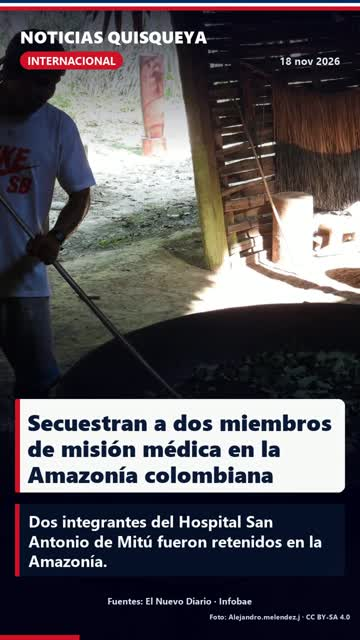

# 🎬 Auto Clip

**Fábrica automática de videos cortos para Facebook e Instagram.**
Escribe, produce, programa y publica reels **sin intervención humana**, y usa sus propias estadísticas
para decidir qué tipo de video hacer más.

| Reflexión diaria | Noticia automática | Curiosidad |
|---|---|---|
|  |  |  |

## Resultados reales
En su **primera semana** publicando en una página nueva: **+12.000 visualizaciones** en Facebook,
con reels que pasaron de 2.700 y 3.300 vistas. Hoy gestiona dos páginas (contenido + noticias) solo.

## Qué hace
| Módulo | Descripción |
|---|---|
| **Guiones** | Almacén de guiones por categoría (reflexiones, curiosidades, historias…), elegidos según el rendimiento de cada formato. |
| **Producción** | Voz neural, imágenes por escena, subtítulos animados, titular "gancho" en los primeros 3 s, música y portada. Codifica con aceleración por GPU (Intel QuickSync). |
| **Noticias** | Lee 12 medios dominicanos e internacionales (RSS), agrupa la misma noticia en varias fuentes, la redacta con IA **verificando que las cifras salgan de las fuentes**, busca fotos con licencia libre y la monta estilo noticiero. Cola en orden de llegada y caducidad. |
| **Clips de directos y videos** | Graba tramos de transmisiones en vivo o toma videos con licencia Creative Commons, transcribe el audio y la IA elige los mejores momentos, siempre con créditos a la fuente. |
| **Publicación** | Sube a Meta Business Suite con un navegador automatizado: horarios, límite diario, nunca dos seguidos en la misma página, reintentos y capturas si algo falla. |
| **Estadísticas** | Lee las métricas de cada reel (vistas, retención, interacciones) y ajusta qué formatos producir más. |
| **Modo nocturno** | Corre oculto en segundo plano, se recupera solo de cortes de internet y de errores de la IA. |

## Tecnologías
Python · FFmpeg · Selenium · SQLite · Pillow · Whisper (transcripción) · Google Gemini (IA) · edge-tts (voz) · RSS · APIs de Wikimedia Commons y Openverse · tkinter (interfaz)

## Cómo está organizado
```
autoclip/
├── nocturno.py        el "piloto automático": decide qué producir y cuándo publicar
├── guiones.py         almacén de guiones y reparto por rendimiento
├── crear.py, render.py   producción del video (voz, escenas, subtítulos, gancho)
├── noticias.py        noticias: fuentes, agrupación, redacción, fotos y montaje
├── publicar.py        subida a Meta con navegador automatizado
├── estadisticas_*.py  métricas y análisis por formato, horario y voz
└── db.py              base de datos SQLite (clips, publicaciones, métricas)
```

## Sobre el código
Auto Clip es un **producto que vendo**, por eso el código fuente es privado.
Si eres reclutador o te interesa, escríbeme y te lo muestro en una llamada.

## Lo que aprendí
- Diseñar un sistema **que corre solo durante días** y se recupera de fallos (internet, IA saturada, páginas que cambian)
- Procesar video y audio con **FFmpeg**
- Automatizar navegadores con **Selenium** de forma robusta
- Usar **datos** (métricas reales) para tomar decisiones de producto
